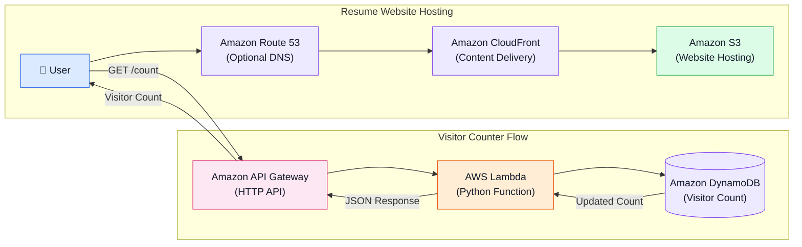

# ☁️ Cloud Resume Challenge — AWS Serverless Portfolio

A responsive, dark editorial-style resume portfolio hosted on AWS using a serverless architecture. This project demonstrates static website hosting, content delivery, API integration, serverless computing, and database management.

## 🏗️ Architecture Diagram

The architecture consists of two main workflows:

- **Resume Website Hosting** — Delivers the portfolio website to visitors.
- **Visitor Counter** — Tracks and displays the total number of website visits.



**Note:** Route 53 is optional. This deployment uses the default CloudFront domain because a custom domain was not configured.

## 📌 Project Overview

This project hosts a personal resume website on AWS and implements a serverless visitor counter to track website visits.

## 🛠️ AWS Services Used

| AWS Service | Purpose |
|---|---|
| Amazon S3 | Stores static website files |
| Amazon CloudFront | Content delivery and HTTPS |
| Amazon Route 53 | Optional DNS and custom domain |
| Amazon API Gateway | Exposes visitor counter HTTP API |
| AWS Lambda | Executes visitor counter logic |
| Amazon DynamoDB | Stores visitor count |

## 💻 Technologies Used

- HTML5
- CSS3
- JavaScript
- Python 3.12
- AWS
- Git
- GitHub

## 📂 Project Structure

```text
cloud-resume-challenge/
│
├── index.html
├── style.css
├── script.js
├── README.md
│
└── backend/
    └── lambda_function.py
```

## ✨ Features

- Responsive resume portfolio.
- Dark editorial-style design.
- Mobile-friendly navigation.
- Dynamic footer year.
- AWS-hosted static website.
- Secure HTTPS delivery through CloudFront.
- Serverless visitor counter.
- API integration using API Gateway.
- Python-based Lambda function.
- Persistent visitor count using DynamoDB.

## 🔄 Visitor Counter Workflow

1. A visitor opens the resume website.
2. JavaScript sends a GET request to API Gateway.
3. API Gateway invokes the Lambda function.
4. Lambda updates the visitor count in DynamoDB.
5. DynamoDB returns the updated count.
6. Lambda sends the count as a JSON response.
7. JavaScript displays the updated visitor count on the website.

## 🚀 Deployment Steps

### 1. Frontend Development
- Created the resume website using HTML, CSS, and JavaScript.
- Tested the website locally using VS Code Live Server.

### 2. Amazon S3
- Created an S3 bucket.
- Uploaded the static website files.
- Kept the bucket private.

### 3. Amazon CloudFront
- Created a CloudFront distribution.
- Connected S3 using Origin Access Control (OAC).
- Configured `index.html` as the default root object.
- Enabled HTTPS delivery.

### 4. Amazon DynamoDB
- Created the `ResumeVisitorCounter` table.
- Configured `counterId` as the partition key.
- Initialized the visitor count to zero.

### 5. AWS Lambda
- Created a Python Lambda function.
- Connected the function to DynamoDB.
- Configured the required IAM permissions.
- Implemented visitor count updates.

### 6. Amazon API Gateway
- Created an HTTP API.
- Configured the `GET /count` route.
- Integrated the route with the Lambda function.
- Configured CORS for the CloudFront website origin.

### 7. Frontend Integration
- Connected JavaScript to the API Gateway endpoint.
- Displayed the visitor count dynamically.
- Uploaded updated files to S3.
- Invalidated the CloudFront cache.

## 🧪 Testing

- Verified the portfolio website through CloudFront.
- Verified HTTPS access.
- Tested the API Gateway endpoint.
- Verified Lambda execution.
- Confirmed visitor count updates in DynamoDB.
- Tested the visitor counter on the deployed website.

## 🔐 Security Considerations

- S3 bucket is kept private.
- CloudFront uses Origin Access Control (OAC).
- Lambda accesses DynamoDB through IAM permissions.
- API Gateway CORS allows the configured website origin.
- AWS credentials and secret keys are not stored in the repository.

## 📈 What I Learned

- AWS static website hosting.
- CloudFront content delivery.
- Serverless architecture design.
- API Gateway and Lambda integration.
- DynamoDB data management.
- IAM permissions and resource security.
- Frontend-to-backend API integration.
- Git and GitHub project documentation.

## 👩‍💻 Author

**Sowmiya Saravanan**
